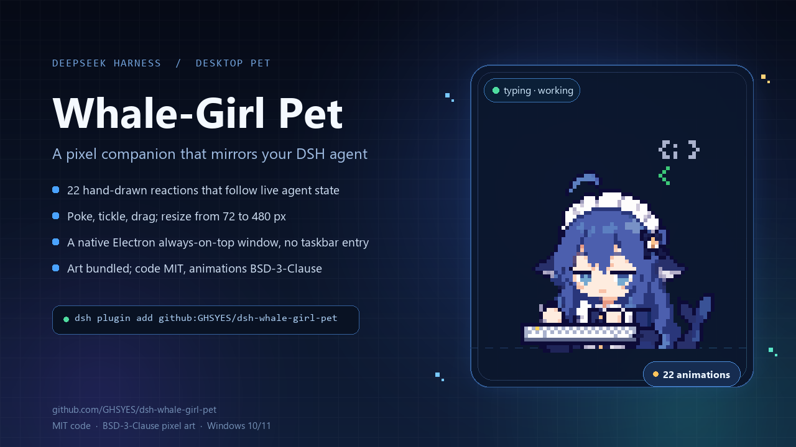
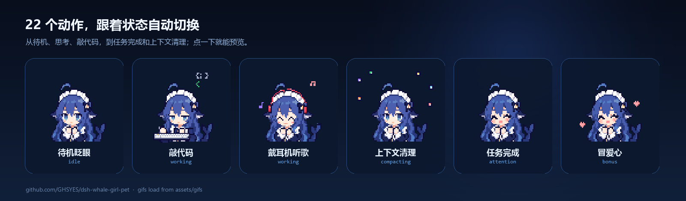

# Whale-Girl Pet · dsh-whale-girl-pet

**Turns your DeepSeek Harness (DSH) session state into a pixel whale-girl who actually lives on your Windows desktop.**

[中文](README.md)





## What it is

This is not a widget inside the web page. The pet is a separate transparent, always-on-top Electron window on your Windows desktop: no taskbar entry, no duplicate overlay inside DSH. It listens to real host events — sessions, tool calls, approvals, subagents, archived sessions — and maps what the agent is doing to 22 pixel animations. You can poke her, tickle her, hold Ctrl to drag her around, and resize her at any time.

The art ships with the plugin, so a fresh install works out of the box. Drop same-named files into `%DSH_HOME%\pets\whale-girl-emoji` to override the bundled set.

## Features

- **Live state, not random animation.** Priority chain:
  `settings preview > interaction reaction > waiting for approval/question > error > context compaction/archive > worktree carrying > subagent juggling (>=2) > building (>=3 sessions using tools) > music (2) > typing (1) > thinking (turn running) > task complete (loop until clicked) > sleeping (60s idle) > idle pool (7 animations, rotates every 30s)`.
- **Completion that waits for you.** A normal main-session turn end, or a workbench task moving to done, starts a looping "task complete" animation. One click acknowledges it, plays a thumbs-up, and returns to normal. Subagent completion and errors never celebrate.
- **Interactions.** Click the left/right half = poke; three clicks within one second = tickle; **hold Ctrl and drag** = pick her up (a plain drag does not move the window); right-click = native menu (zoom in / out / reset / hide). Clicking a sleeping pet wakes her.
- **Small surprises.** 12% of pokes turn into hearts; 18% of normal turn ends turn into hearts instead of the completion loop.
- **Live resize.** 72–480 px in Settings, or ±32 px per right-click menu action. Position and size persist in `%DSH_HOME%\whale-pet\desktop\window-state.json`.
- **Settings panel.** DSH Settings → Whale-Girl Pet: desktop toggle, size, opacity, click-through, idle rotation, and a clickable preview grid of all 22 animations.
- **Archiving reacts too.** Archiving a session plays the context-compaction animation for about 4 seconds.
- **Electron on first run.** If no runtime is available, the plugin downloads the pinned Electron 44.0.0 win32-x64 build from npmmirror or GitHub Releases, verifies its SHA-256, and extracts it. An existing dsh-orb runtime is reused.

## Requirements

- Windows 10/11 x64
- DSH Desktop (`engines.dsh >= 0.2.0-rc.2`), Node.js 20+
- Disk: about 3.5 MB for the plugin, about 160 MB download / 370 MB extracted for the Electron runtime (skip it if dsh-orb is already installed)
- Optional: `@dely0/dsh-personal-workbench` for the workbench-completion loop

## Install

### Plugin market (recommended)

Open **Plugins → Discover / Market** in DSH and search for `dsh-whale-girl-pet` or "Whale-Girl Pet". The catalog syncs from awesome-dsh-plugin, so a newly accepted entry usually appears within a day. If it is not there yet, use the CLI route below.

### CLI

```powershell
dsh plugin --profile desktop add github:GHSYES/dsh-whale-girl-pet
```

`dsh plugin` forwards to pnpm and, on success, writes `dsh-whale-pet` into the profile's `dsh.profile.bundles`. Restart DSH Desktop (host-side plugins are loaded at boot). If it says `Open DeepSeek Harness Desktop once to initialize its profile`, launch DSH Desktop once, quit it completely, then rerun the command. If the panel does not appear, check `%DSH_HOME%\profiles\desktop\package.json` and make sure `bundles` contains `dsh-whale-pet`.

### Manual

```powershell
git clone https://github.com/GHSYES/dsh-whale-girl-pet.git "$env:USERPROFILE\.dsh\plugins\dsh-whale-pet"
dsh plugin --profile desktop add "file:$env:USERPROFILE\.dsh\plugins\dsh-whale-pet"
```

Restart DSH Desktop.

### Offline / no automatic Electron download

Either:

1. Install [dsh-orb](https://github.com/mini-yifan/dsh-orb); the pet reuses `%DSH_HOME%\dsh-orb\electron-runtime\electron.exe`; or
2. Point `WHALE_PET_ELECTRON` at your own Electron 44.x `electron.exe` before starting DSH.

Download logs live in `%DSH_HOME%\whale-pet\spawn.log` and `desktop.log`. The settings panel shows progress, failure details, and a retry button.

## Settings panel

DSH Settings → Whale-Girl Pet:

| Control | Effect |
| --- | --- |
| Show on desktop | Start/hide the desktop window; downloads Electron automatically when needed |
| Size | 72–480 px, applied to the window immediately |
| Opacity | 20%–100% |
| Click-through | Let mouse events pass through the pet window |
| Idle rotation | Off fixes idle to the blinking animation |
| State preview | 22 animation tiles; click one to force it for 3 seconds |

## The 22 animations

| Animation | Key | Trigger |
| --- | --- | --- |
| Idle blink | `idle` | Nothing to do; idle pool |
| Look around | `idle-look` | Idle pool |
| Happy spout | `idle-spout` | Idle pool |
| Thinking | `thinking` | A turn is running |
| Typing | `typing` | One session is using tools |
| Music | `music` | Two sessions using tools; also idle pool |
| Subagent juggling | `conducting` | >=2 subagents; also idle pool |
| Building | `building` | >=3 sessions using tools; also idle pool |
| Error | `error` | Tool failure or abnormal turn end, about 4.5s |
| Task complete | `happy` | Main-session turn end or workbench done; loops until clicked |
| Needs approval | `notification` | Approval or question is waiting |
| Compacting | `compacting` | Context compaction or archived session, about 4.2s |
| Carrying | `carrying` | Worktree created, about 4.2s |
| Sleeping | `sleeping` | 60s without events |
| Waking | `waking` | Click while sleeping |
| Poke left | `poke-left` | Click left half |
| Poke right | `poke-right` | Click right half |
| Tickle | `tickle` | Three clicks within one second |
| Picked up | `drag` | Hold Ctrl and drag |
| Swim | `swim` | Idle pool |
| Hearts | `smile-hearts` | 12% of pokes / 18% of normal turn ends |
| Thumbs up | `thumbs-up` | Acknowledge the completion loop |

## Data and privacy

- State, settings, and window geometry stay in `%DSH_HOME%\whale-pet\`.
- No telemetry. The only outbound request is the first-time Electron runtime download.
- Workbench polling only hits the local DSH `GET /api/workbench/tasks` (every 2s; failures are ignored).
- The desktop window loads the local `/whale-pet/standalone` route; it never opens a remote page.

## HTTP routes (prefix `/whale-pet`)

| Method | Path | Purpose |
| --- | --- | --- |
| GET | `/api/state` | Current animation, GIF, settings, session stats, Electron status |
| GET | `/api/catalog` | The 22 animations and runtime status |
| GET/POST | `/api/settings` | Read / merge-write settings |
| GET/POST | `/api/runtime` | Inspect / retry the Electron runtime download |
| POST | `/api/hello` | Frontend origin report; changing ports restart the desktop window |
| POST | `/api/interaction` | `poke-left` / `poke-right` / `tickle` / `drag` / `drag-end` / `waking` |
| POST | `/api/desktop` | `{open:true}` show / `{open:false}` hide |
| POST | `/api/preview` | Force an animation for 3 seconds |
| GET | `/standalone` | Transparent desktop page |
| GET | `/standalone.js` | Desktop interaction script |
| GET | `/assets/<file.gif>` | GIFs (a same-named library file wins) |

## Implementation notes

- `index.js`: ESM host plugin. State machine + HTTP routes + Electron process management. Routes are registered through `ctx.inject(['webServer'], ...)`; `webServer.getOrigin()` keeps the window pointed at the current port. The window self-heals every 10s and is stopped when the host exits.
- `runtime.js`: Electron 44.0.0 downloader. npmmirror then GitHub Releases, resumable download, SHA-256 verification, tar/PowerShell extraction, atomic replace.
- `client.js`: settings section only (`slots.inject('settings.section', ...)`); no in-page overlay.
- `desktop/main.js`: transparent frameless window, `alwaysOnTop('screen-saver')`, `skipTaskbar`, single-instance lock, debounced geometry persistence, native context menu.
- `standalone.js`: Ctrl drag, left/right-half poke, triple-click tickle, wake-on-click, menu commands.
- `desktop/preload.js`: exposes `window.whalePet.move/dragStart/dragEnd/resizeTo/setClickThrough/hide/show/close/openMenu/onCommand`.

## Known limitations

- Closing DSH closes the pet; opening DSH brings it back.
- Changes to `index.js` / `runtime.js` / `desktop/*` need a DSH Desktop restart. Changes to `standalone.js` only need the pet window restarted; `client.js` only needs a page refresh.
- The workbench integration depends on `@dely0/dsh-personal-workbench` and its `GET /api/workbench/tasks`. It is skipped silently when unavailable. Tasks already done at startup are treated as a baseline, so old tasks are not celebrated.
- Automatic Electron download is Windows x64 only; other platforms must set `WHALE_PET_ELECTRON`.
- A single-instance lock allows one pet window per Windows user; launching again focuses the existing one.

## Art and licenses

- **Code:** MIT, see [LICENSE](LICENSE).
- **The 22 pixel GIFs:** BSD-3-Clause, original author lhh010, from [lhh010/dsh-ui-whale](https://github.com/lhh010/dsh-ui-whale); asset page: [whale-girl pixel emoji set](https://dshtui.com/pets/whale-girl-emoji/). Full notice: [THIRD-PARTY-NOTICES.md](THIRD-PARTY-NOTICES.md).
- When redistributing, keep `LICENSE` and `THIRD-PARTY-NOTICES.md`. MIT does not cover the art.

## Development

```bash
node --check index.js
node --check runtime.js
node --check client.js
node --check standalone.js
```

The plugin directory is the installable package. Keep `assets/` (22 GIFs + `catalog.json`) with the code; copying only `index.js` will not run.

---

If the whale-girl made you smile while waiting for a model, a star is welcome.
