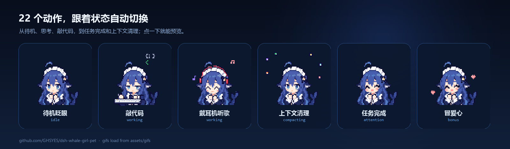

# 鲸娘桌宠 · dsh-whale-girl-pet

**把 DeepSeek Harness（DSH）的会话状态，变成一只真的住在 Windows 桌面上的像素鲸娘。**

[English](README.en.md)




## 它是什么

这不是一个网页里的小挂件：鲸娘是一个独立的 Electron 透明置顶窗口，浮在 Windows 桌面上，不占任务栏，也不会在 DSH 页面里重复出现。她监听 DSH 宿主真实的会话、工具调用、审批、子代理、归档事件，把「我正在干什么」翻译成 22 个像素动作；你还可以戳她、挠她、按住 Ctrl 把她拎走、随时缩放。

素材随插件一起分发，安装完就能用；本机 `%DSH_HOME%\pets\whale-girl-emoji` 里的同名素材会覆盖内置版本，方便换装。**素材均来源于dsh-tui**

## 能力

- **实时状态**：不是定时随机，而是真读会话事件。状态优先级：
  `设置预览 > 互动反应 > 等待确认（审批/提问） > 出错 > 上下文清理/会话归档 > 抱书搬运（worktree） > 小鲸鱼分身（≥2 子代理） > 施工中（≥3 个会话在调工具） > 听歌（2 个） > 敲代码（1 个） > 思考（回合未结束） > 任务完成（循环，点一次才停） > 呼呼大睡（5 分钟无互动） > 待机循环（眨眼 30 秒 + 随机 1 个其他动作，只播一轮）`。
- **待机是循环，不是一直眨眼**：每一轮先「待机眨眼」30 秒，然后随机播 1 个其他待机动作（只播一轮），再回到眨眼；5 分钟没有互动就进入「呼呼大睡」，一直睡到你点她，醒后重新开始循环。会话、工具、审批等真实状态始终优先。
- **完成任务会一直提醒**：主会话正常结束，或者个人工作台里有任务验收通过，鲸娘会循环播「任务完成」；单击她一次，才播「举大拇指」并回到正常待机。子代理收尾不会误触发；出错也不会庆祝。
- **可以交互**：单击左脸/右脸 = 挨戳；1 秒内连点 3 下 = 挠痒；**按住 Ctrl 再拖** = 拎起来换位置（普通拖动不会移动窗口）；右键 = 原生菜单（放大 / 缩小 / 恢复默认 / 收起）。睡着时点她会先被吵醒。
- **彩蛋**：戳脸有 12% 概率变成「冒爱心」；主会话正常结束有 18% 概率冒爱心（其余进任务完成循环）。
- **实时缩放**：设置里 72–480 px；右键菜单每次 ±32 px；窗口位置和大小记在 `%DSH_HOME%\whale-pet\desktop\window-state.json`，下次原位复原。
- **设置交互面板**：DSH 设置 →「鲸娘桌宠」。显示开关、大小、不透明度、点击穿透、待机轮换，以及全部 22 个动作的点击预览。
- **归档会话也有反应**：归档一个会话时播「上下文清理」约 4 秒。
- **首次运行自动准备 Electron**：没有现成 Electron 时，从 npmmirror / GitHub Releases 下载固定版本 44.0.0 的 win32-x64 运行时，SHA-256 校验后解压；已经装过 dsh-orb 的话直接复用它的运行时。

## 环境

- Windows 10/11 x64
- DSH Desktop（`engines.dsh >= 0.2.0-rc.2`），Node.js 20+
- 磁盘：插件约 3.5 MB；Electron 运行时下载约 160 MB、解压约 370 MB（已有 dsh-orb 运行时则不需要重复下载）
- 可选：`@dely0/dsh-personal-workbench`，用于「工作台验收通过 → 任务完成循环」

## 安装

### 插件市场（推荐）

在 DSH 的 **插件 → 发现 / 插件市场** 里搜索 `dsh-whale-girl-pet` 或「鲸娘桌宠」，点安装。市场目录从 awesome-dsh-plugin 同步，收录后通常一天内出现；暂时搜不到就用下面的界面或命令行方式。

### DSH 界面「添加插件」

打开 **插件 → 添加插件**，在输入框里填：

```text
github:GHSYES/dsh-whale-girl-pet
```

也可以填完整地址 `(https://ghfast.top/https://github.com/GHSYES/dsh-whale-girl-pet/archive/refs/heads/main.tar.gz)`。这里只填“来源”，**不要粘贴整条 `dsh plugin ... add ...` 命令**，否则会报“无法识别这个包名或地址”。

### 命令行

```powershell
dsh plugin --profile desktop add github:GHSYES/dsh-whale-girl-pet
```

`dsh plugin` 会把参数转发给 pnpm，成功后自动把 `dsh-whale-pet` 写进 profile 的 `dsh.profile.bundles`。重启 DSH Desktop 生效（宿主插件只在启动时加载）。 如果提示 `Open DeepSeek Harness Desktop once to initialize its profile`，先启动一次 DSH Desktop 再完全退出，然后重跑命令。如果入口没出现，打开 `%DSH_HOME%\profiles\desktop\package.json` 确认 `bundles` 里有 `dsh-whale-pet`。

### 手动安装

```powershell
git clone https://github.com/GHSYES/dsh-whale-girl-pet.git "$env:USERPROFILE\.dsh\plugins\dsh-whale-pet"
dsh plugin --profile desktop add "file:$env:USERPROFILE\.dsh\plugins\dsh-whale-pet"
```

重启 DSH Desktop。

### 没有网络 / 不想自动下载 Electron

任选一种：

1. 安装 [dsh-orb](https://github.com/mini-yifan/dsh-orb)，插件会自动复用 `%DSH_HOME%\dsh-orb\electron-runtime\electron.exe`；
2. 自己准备 Electron 44.x，把环境变量 `WHALE_PET_ELECTRON` 指向 `electron.exe` 再启动 DSH。

下载日志在 `%DSH_HOME%\whale-pet\spawn.log` 和 `desktop.log`；设置面板会显示下载进度与失败原因，并提供「重试」。

## 交互面板

DSH 设置 → 鲸娘桌宠：

| 控件 | 作用 |
| --- | --- |
| 显示在桌面上 | 启动/收起桌面窗；Electron 未就绪时自动下载并显示进度 |
| 大小 | 72–480 px，桌面窗即时 resize |
| 不透明度 | 20%–100% |
| 点击穿透 | 打开后鼠标事件穿透桌面窗（防止挡住工作） |
| 待机轮换 | 关闭后待机固定为「待机眨眼」 |
| 状态预览 | 22 个动作网格，点一下强制播放 3 秒 |

## 22 个动作

| 动作 | key | 什么时候出现 |
| --- | --- | --- |
| 待机眨眼 | `idle` | 没活；待机循环的 30 秒眨眼 |
| 东张西望 | `idle-look` | 待机循环，随机出现，只播一轮 |
| 开心喷水 | `idle-spout` | 待机循环，随机出现，只播一轮 |
| 思考中 | `thinking` | 回合已开始、还没结束 |
| 敲代码 | `typing` | 1 个会话正在调工具 |
| 戴耳机听歌 | `music` | 2 个会话在调工具；也在待机循环 |
| 小鲸鱼分身 | `conducting` | ≥2 个子代理；也在待机循环 |
| 施工中 | `building` | ≥3 个会话在调工具；也在待机循环 |
| 出错啦 | `error` | 工具失败 / 回合异常结束，约 4.5 秒 |
| 任务完成 | `happy` | 主会话正常结束 / 工作台验收通过，循环到点击确认 |
| 需要你确认 | `notification` | 审批或提问在等你 |
| 上下文清理 | `compacting` | 上下文压缩或归档会话，约 4.2 秒 |
| 抱书搬运 | `carrying` | 创建 worktree，约 4.2 秒 |
| 呼呼大睡 | `sleeping` | 5 分钟没有互动；一直持续到被点醒 |
| 被吵醒 | `waking` | 睡着时点她；醒后回到待机循环 |
| 戳左边 | `poke-left` | 点左半脸 |
| 戳右边 | `poke-right` | 点右半脸 |
| 被挠痒痒 | `tickle` | 1 秒内连点 3 下 |
| 被拎起来 | `drag` | 按住 Ctrl 拖动 |
| 游来游去 | `swim` | 待机循环，随机出现，只播一轮 |
| 冒爱心 | `smile-hearts` | 戳脸 12% / 正常结束 18% |
| 举大拇指 | `thumbs-up` | 单击确认「任务完成」 |

## 数据与隐私

- 全部状态、设置、窗口位置只写本机 `%DSH_HOME%\whale-pet\`。
- 不发送遥测；唯一的主动网络请求是首次下载 Electron 运行时。
- 工作台轮询只访问本机 DSH 的 `GET /api/workbench/tasks`（2 秒一次，接口不可达就静默跳过）。
- 桌面窗加载的是本机 DSH 的 `/whale-pet/standalone`，不访问外部网页。

## 路由（prefix `/whale-pet`）

| 方法 | 路径 | 说明 |
| --- | --- | --- |
| GET | `/api/state` | 当前动作、GIF、设置、会话统计、Electron 状态 |
| GET | `/api/catalog` | 22 个动作与运行时状态 |
| GET/POST | `/api/settings` | 读 / 合并写设置 |
| GET/POST | `/api/runtime` | 查看 / 重试 Electron 运行时下载 |
| POST | `/api/hello` | 前端上报 origin；端口变化会重启桌面窗 |
| POST | `/api/interaction` | `poke-left` / `poke-right` / `tickle` / `drag` / `drag-end` / `waking` |
| POST | `/api/desktop` | `{open:true}` 显示 / `{open:false}` 收起 |
| POST | `/api/preview` | 强制播放某个动作 3 秒 |
| GET | `/standalone` | 桌面窗的透明页 |
| GET | `/standalone.js` | 桌面窗交互脚本 |
| GET | `/assets/<file.gif>` | 22 张 GIF（素材库同名文件优先） |

## 实现要点

- `index.js`：ESM 宿主插件。状态机 + HTTP 路由 + Electron 进程管理。`ctx.inject(['webServer'], ...)` 挂 prefix 路由，用 `webServer.getOrigin()` 校正端口；每 10 秒自愈桌面窗；宿主退出时收掉桌宠。
- `runtime.js`：Electron 44.0.0 运行时下载器。npmmirror → GitHub Releases，断点续传、SHA-256 校验、tar/PowerShell 解压、原子替换。
- `client.js`：只负责设置分区（`slots.inject('settings.section', ...)`），不渲染页内悬浮层。
- `desktop/main.js`：透明无边框、`alwaysOnTop('screen-saver')`、`skipTaskbar`、单实例锁、移动/缩放防抖落盘、原生右键菜单。
- `standalone.js`：桌面页交互——Ctrl 拖动、左右脸判定、三连击、睡着唤醒、右键菜单命令。
- `desktop/preload.js`：`window.whalePet.move/dragStart/dragEnd/resizeTo/setClickThrough/hide/show/close/openMenu/onCommand`。

## 已知限制

- DSH 完全退出后桌宠会关闭；重新打开 DSH 会自动回来。
- 改 `index.js` / `runtime.js` / `desktop/*` 需要重启 DSH Desktop；改 `standalone.js` 只需重启桌宠窗口；改 `client.js` 刷新页面。
- 工作台联动依赖 `@dely0/dsh-personal-workbench` 的 `GET /api/workbench/tasks`；没装时静默跳过。启动时把当时已完成的任务当基线，不会给旧任务补庆祝。
- 自动下载的 Electron 只覆盖 Windows x64；其他平台请设置 `WHALE_PET_ELECTRON`。
- 单实例锁：同一 Windows 用户只允许一个桌宠窗口；重复启动会聚焦已有窗口。

## 素材与许可

- **代码**：MIT，见 [LICENSE](LICENSE)。
- **22 张像素 GIF**：BSD-3-Clause，原作者 lhh010，来自 [lhh010/dsh-ui-whale](https://github.com/lhh010/dsh-ui-whale)；素材页：[鲸娘像素表情集](https://dshtui.com/pets/whale-girl-emoji/)。完整声明见 [THIRD-PARTY-NOTICES.md](THIRD-PARTY-NOTICES.md)。
- 再分发时请保留 `LICENSE` 与 `THIRD-PARTY-NOTICES.md`；MIT 不覆盖美术素材。

## 开发

```bash
node --check index.js
node --check runtime.js
node --check client.js
node --check standalone.js
```

插件目录本身就是可安装包；`assets/` 里的 22 张 GIF 与 `catalog.json` 是运行所需文件，不要只拷 `index.js`。

---

如果鲸娘让你在等模型的时候笑了一下，欢迎点个 Star。
